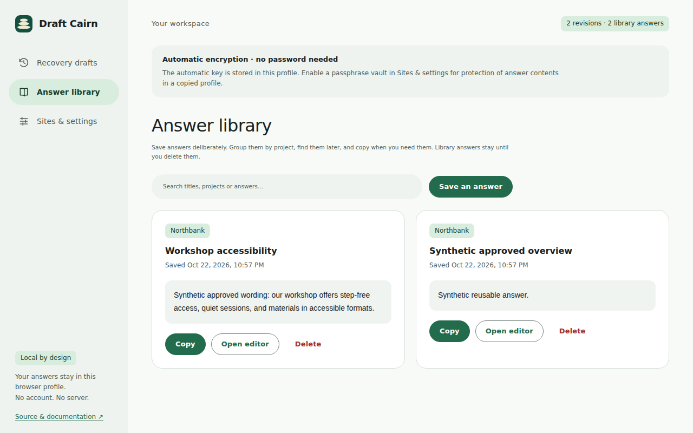

# Draft Cairn


Local answer recovery for long web applications. A free, MIT-licensed Chrome extension for grant writers, consultants, and agencies working through application portals.

Draft Cairn keeps a local safety copy of supported answers on websites you choose.

## Imagine this

1. You're filling in a website's big answer box, perhaps explaining a project in a grant application.
2. You spend half an hour writing.
3. The website reloads or logs you out. Your answer disappears.
4. If Draft Cairn was enabled beforehand and finished saving, you open its recovery workspace, preview your saved answer, and copy it back. You can also explicitly restore it when the original field is confidently matched and empty.

Protection must be enabled before the loss. Wait for **saved on this device**; text that has not finished saving may still be lost. Draft Cairn cannot keep you logged in or recover text written before protection was enabled.

Two other everyday uses:

- **An answer that won't fit.** You paste a 600-unit answer into a field with a declared 500-unit limit. Draft Cairn stops the oversized paste and opens the complete original in a larger editor, so you can edit it yourself. It cannot detect every custom website limit.
- **A paragraph you use again.** You explicitly save an approved project description in the answer library. Next time, search for it and copy it into your application.

This is an early preview. Commercial demand and broad compatibility have not been established. Keep a separate copy of important work.



## Install

1. Download `draft-cairn-0.2.0.zip` from [Releases](https://github.com/librerob/draft-cairn/releases), verify it against `SHA256SUMS`, and extract it.
2. Open `chrome://extensions`, enable Developer mode, choose **Load unpacked**, and select the extracted folder containing `manifest.json`.
3. Pin Draft Cairn. On an ordinary HTTP/HTTPS website, open its popup and choose **Enable for this site**. Approve Chrome's site-access request.
4. Type in a supported field and wait for **saved on this device**. Open **Recovery & library** to inspect saved text.

For a source checkout, load the `extension/` folder directly. Chrome 120 or later is required. This release is not on the Chrome Web Store; no store submission or payment has been made.

Preparing a store listing? The release also includes a separate `draft-cairn-store-kit-0.2.0.zip` with the icon, promotional tile, real-interface screenshots, listing copy, and reviewer instructions. Extract it and use its inner extension ZIP for the package upload. [Asset guide](docs/store/README.md) · [Final manual checks](docs/store/manual-smoke-test.md). Those manual permission and clipboard checks remain pending; prepared assets do not imply store approval.

## What it saves

- Visible, editable standard textareas, and ordinary text inputs with a declared `maxlength` of at least 120.
- Up to 180 recovery records in a rolling history; the oldest recovery records are removed when the count or byte budget is reached, with a visible notice. Explicit library answers are never evicted. Up to four snapshots per field. Rapid edits update the current snapshot; revisions at least 30 seconds apart can remain as earlier snapshots.
- One day of recovery by default on new installs (existing choices are preserved), configurable to 1, 3, 7, 14, or 30 days. Complete oversized pastes expire within one hour. Expiry cleanup runs hourly while Chrome is running and on reads/startup.
- Library answers with a title and optional project. These remain until deleted; import/export uses a [documented v1 format](docs/library-format.md).

The current release supports only the top-level page. Rich text editors, contenteditable, frames, browser-internal pages, and incognito are excluded. See [compatibility](docs/compatibility.md).

## Privacy and control

No analytics, accounts, advertising, remote AI, or answer transmission. Storage is in this browser profile, not synchronized. No URL query strings, fragments, or raw paths are stored. Page titles and field details are optional and off by default for new installs. Enabling them permits direct restoration when the match is safe; without them, drafts are copy-only. Existing installations keep their previous choice. Turning the option off removes those details from existing drafts.

Password, payment, one-time-code, hidden, disabled, read-only, and sensitive-hint fields are excluded. Sensitive autocomplete tokens are excluded; `autocomplete="off"` is supported. Specific credential/payment phrases are filtered without rejecting ordinary narrative labels such as “payment schedule”. The on-page status says when the focused field is unsupported. Filtering cannot identify every confidential answer. Answer records are encrypted automatically with a non-extractable key in this profile. For password-free use, leave that default on. For protection of answer contents in copied profile files, enable the optional **passphrase vault** in Sites & settings. New drafts still save while locked; unlock to read, search, restore or change library answers. A forgotten passphrase means losing those answers. The operational index, including selected origins, hashes, sizes and times, has a separate automatic key in the profile, so the vault does not hide that metadata from a profile holder. Neither mode protects an actively compromised browser/device. See the precise boundaries below. Read the [privacy policy](PRIVACY.md) and [security policy](SECURITY.md) before using client information.

Block sites from the popup or exclude fields from the on-page editor. Exclusions can be removed in workspace settings. Choose session-only recovery to clear drafts when the browser/extension session ends; Chrome can keep running after its last window closes. This smaller 2 MiB buffer evicts oldest drafts if necessary; library answers stay persistent.

Delete one revision, a site's drafts and access, or all extension data in the workspace. The popup also offers Delete all, including while locked. Manually saved library answers have no site association; delete them separately or use Delete all. Choose readable JSON or passphrase-encrypted library exports. Export passwords are independent of the vault. Exports and clipboard contents, including OS clipboard history, remain outside the extension.

## Choose your encryption

| Choice | Daily use | Protection boundary |
| --- | --- | --- |
| Automatic (default) | No passphrase; answers open immediately | Encrypted record bytes; the key stays in the same profile, so a copied complete profile can expose answers. |
| Optional passphrase vault | Save while locked; unlock once per browser session to read | Protects encrypted answer contents in copied files/backups made after setup. Operational metadata uses a same-profile automatic key; it is readable to a profile holder. Forgotten passphrases cannot be recovered. |

In settings choose **Enable passphrase vault**, enter and confirm at least 12 characters, and acknowledge the recovery limit. **Lock vault** hides saved answers and clears unsaved workspace editors; it does not erase text on websites, open on-page editors, exported files or the clipboard. Close those separately when needed. Changing the vault passphrase leaves previously exported files unchanged. Returning to automatic encryption requires the current passphrase and re-encrypts existing answers. Keep a separate backup of important work; local storage and browser profiles can be lost.

## Development and demo

Requires Node.js 24 and Python 3. No runtime dependencies or build step.

```sh
npm ci --ignore-scripts
npm test
npm run check
npm run demo
```

Open `http://127.0.0.1:8765/index.html`, enable protection, and use synthetic answers. The demo intentionally loses text on reload and has a **Simulate session expiry** button. Test the two identically labelled fields, excluded inputs, selection-aware oversized pastes, and emoji.

```sh
npx playwright install --with-deps chromium
npm run test:browser
python3 scripts/package.py
```

On Windows use `python` instead of `python3`. Browser tests use trusted keyboard paste with a browser-populated clipboard, an isolated temporary profile and a test-only localhost host pre-grant. They exercise the shipped JavaScript; they do not automate Chrome's native permission dialog or revocation. Set `CHROMIUM_PATH` to a Chrome for Testing executable if necessary. [Validation notes](docs/validation.md) separate local, CI, and unverified checks.

The package script uses an exact file allowlist, fixed metadata, and uncompressed ZIP entries for reproducible bytes. The extension ZIP contains only the 18 runtime files; source, demo, tests, and policies remain in this repository. Icon generation is reproducible with `python3 scripts/icons.py`.

The separate store kit uses the committed listing screenshots, so fresh test screenshots cannot change its bytes. Check store image dimensions and transparent icon margins with `python3 scripts/check-assets.py`.

## Design and release notes

Plain JavaScript, HTML, and CSS keep review and maintenance straightforward. The service worker validates messages, serializes storage changes, limits size, and restricts direct storage access to trusted extension pages. Content scripts only receive their own save responses and explicitly requested restores. User text is rendered with `textContent` or `value`.

Restoration uses a hashed page path, a stable field descriptor, and the ordered form structure. Duplicate or missing identities refuse restoration. Pages with query strings or fragments support copying only. This conservatism reduces wrong-field restoration; it cannot prove that a website has kept the same meaning for an identifier. Always check restored text before submitting.

- [Commercial validation](docs/commercial-validation.md) — first users, alternatives, and decision criteria.
- [Costs](docs/costs.md) — current requirements, no recurring infrastructure, future cost categories.
- [Store listing and submission checklist](docs/chrome-web-store.md).
- [Release notes](docs/release-notes.md).

No paid services or paywalls are included. No verified sponsorship destination was available, so no sponsorship link is included.
